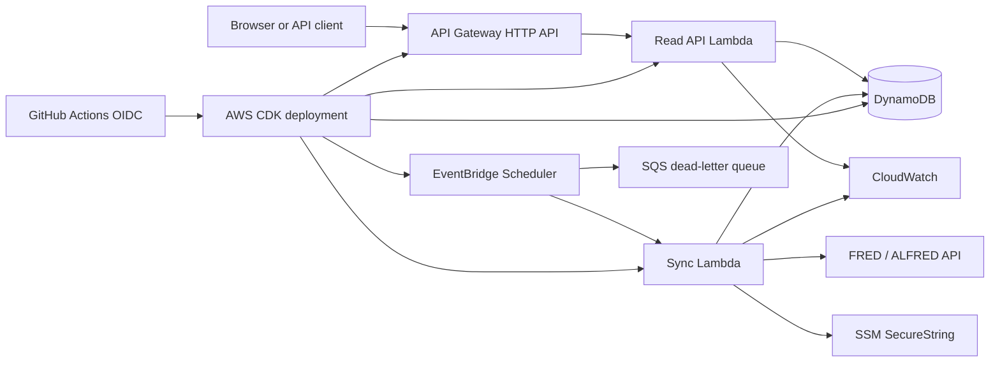
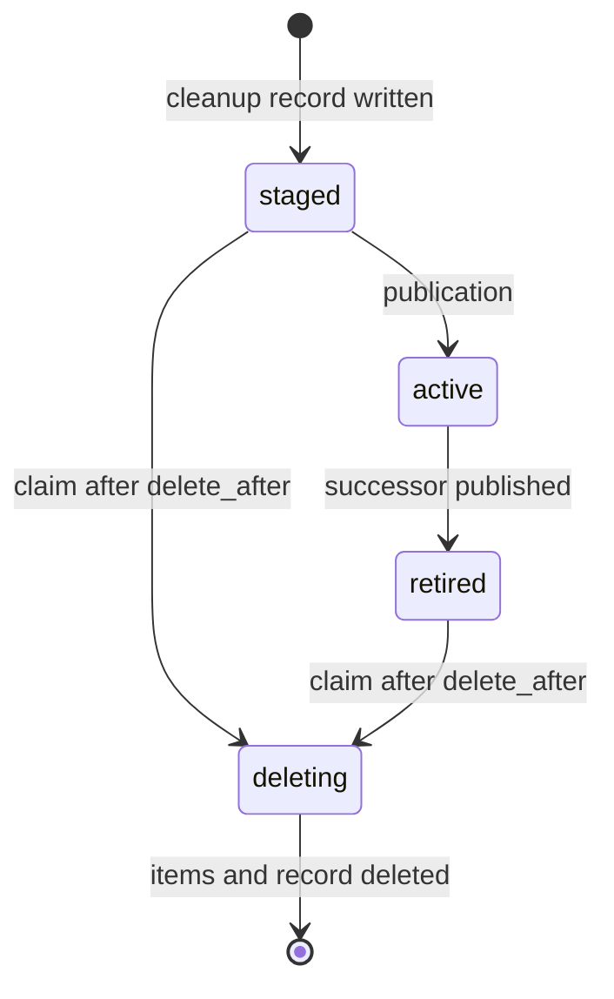

# AWS architecture

This document describes a planned target architecture for v1.0. None of these AWS resources are deployed today. The DynamoDB storage adapter described below exists in `src/asof/dynamodb.py` and is tested against a local emulation only. Deployment begins only after the storage adapter, infrastructure code, IAM policies, and cost controls have been implemented and reviewed.

## Goals

- Run the public read API without an always-on server.
- Refresh economic data on a schedule.
- Keep the FRED key out of the API runtime.
- Give each function only the permissions it needs.
- Make the entire environment reproducible from source control.
- Keep an idle portfolio deployment inexpensive.

## Proposed design

### Read API

Use the existing FastAPI application as one Python Lambda Event Function behind an API Gateway HTTP API. Keeping it as a small “lambdalith” preserves the tested HTTP interface during the first migration. Splitting every route into a separate function would add deployment and IAM complexity without improving this low-traffic read API.

The function uses on-demand Lambda capacity because portfolio traffic is intermittent and should scale to zero. API Gateway HTTP API is sufficient because the project does not need REST API features such as API keys, usage plans, response transformation, or built-in caching.

The read function receives read-only access to the DynamoDB table. It does not receive the FRED key or permission to write data.

### Scheduled sync

EventBridge Scheduler invokes a separate sync Lambda once per day. The job refreshes a recent observation window and writes the resulting vintages to DynamoDB. The operation must remain idempotent because scheduled delivery and Lambda invocation are at least once.

The schedule must not be enabled until the cleanup worker described under [Retiring old generations](#retiring-old-generations) exists. Each replaced history leaves its previous generation in the table, so a recurring sync without cleanup grows storage without bound.

The scheduler uses a retry policy and an SQS dead-letter queue. The sync function can read the FRED key from an SSM SecureString parameter and can write only to the AsOf table. It has no API Gateway permissions.

### DynamoDB data model

One planned table stores an active-generation manifest for each observation, immutable vintage generations, and cleanup records. A series metadata item is reserved in the layout but is not written yet, because nothing fetches series metadata today.

| Item | Partition key | Sort key | Important attributes |
| --- | --- | --- | --- |
| Series metadata (reserved) | `SERIES#PAYEMS` | `META` | title, units, frequency |
| Observation manifest | `SERIES#PAYEMS` | `OBS#2008-08-01` | `active_generation`, `vintage_count`, `updated_at` |
| Vintage value | `SERIES#PAYEMS#OBS#2008-08-01#GEN#<id>` | `VINTAGE#2008-09-05` | value |
| Cleanup record | `SERIES#PAYEMS` | `RETIRE#2008-08-01#<id>` | `generation_key`, `lifecycle`, `delete_after` |

The manifest is a per-observation pointer, not a copy of the revision history. Vintage items are never changed after their generation is written. This layout supports the current access patterns without a table scan:

- List observations by querying `SERIES#<id>` with an `OBS#` sort-key prefix.
- Load a full history by reading the manifest and querying its active generation.
- Find the latest vintage on or before an as-of date by reading the manifest, then querying the active generation with an upper sort-key bound, descending order, and a limit of one.

The manifest `GetItem` uses `ConsistentRead=true`. [DynamoDB defaults to eventually consistent reads](https://docs.aws.amazon.com/amazondynamodb/latest/developerguide/HowItWorks.ReadConsistency.html), which could briefly return the previous pointer after a completed sync; a strongly consistent read ensures the request pins the latest successfully published generation. The manifest is stored in the base table because global secondary indexes do not support strongly consistent reads.

Queries against the active generation are strongly consistent as well. Staging finishes immediately before the pointer moves, so an eventually consistent query could otherwise return part of a generation that was just published. A full-history read also compares the number of vintages it found with the manifest's `vintage_count` and fails rather than return a short history.

`delete_after` is an ISO 8601 UTC string, not an epoch number. DynamoDB TTL must not be enabled on it: TTL would delete the cleanup record by itself and leave its generation untracked.

The PostgreSQL and SQLite stores remain supported and keep their existing whole-batch transactions. The planned DynamoDB adapter will implement the same `RevisionStore` interface, whose portable guarantee is narrower: one observation history becomes visible atomically, while a multi-observation sync may become visible observation by observation.

### Publishing a generation

Each observation is published independently:

1. Read its manifest with a strongly consistent read and remember the current generation, `G0`. If `vintage_count` matches, query `G0` and compare its stored items with the history being saved. If they are identical, stop: nothing is written. The comparison reads the items themselves, so saving a history again replaces a generation that has lost or changed items.
2. Write the `RETIRE` record for the new generation, `G1`, before writing any vintage items. Its `lifecycle` is `staged` and its initial `delete_after` is 30 minutes after staging begins, so a crash during staging still leaves a durable cleanup record.
3. Write the complete replacement history under the immutable `G1` partition. Retried writes use the same generation identifier and values, so this staging step is idempotent.
4. Publish `G1` with one transaction containing:
   - the [conditional manifest write](https://docs.aws.amazon.com/amazondynamodb/latest/developerguide/Expressions.ConditionExpressions.html), which requires `active_generation = G0`, or that `active_generation` does not exist for a first publication;
   - an update that moves `G1`'s `RETIRE` record from `staged` to `active`, and fails if the record is in any other state;
   - when `G0` exists, an update that moves `G0`'s `RETIRE` record to `retired` with a `delete_after` 30 minutes after this publication.
5. If the condition fails, another sync has already changed the pointer. The losing sync must not overwrite it. It re-reads the manifest: if the active generation already holds the same content, the save succeeds; otherwise it raises a concurrency error and the caller decides whether another refresh is needed. The prewritten `G1` record makes the unused generation eligible for later cleanup.
6. If the transaction is cancelled and the pointer has not moved, the writer reads `G1`'s `RETIRE` record. If it is no longer `staged`, cleanup has claimed the generation: the save fails without publishing and a later save stages a new generation. Otherwise the cancellation was transient and the transaction is retried a bounded number of times.

The conditional manifest update is the commit point. Readers see either the complete old generation or the complete new generation, and two overlapping syncs that started from the same pointer cannot overwrite one another.

### Retiring old generations

Every generation receives a cleanup record before staging starts. This ordering means a sync that crashes after writing some or all of `G1`, but before updating the manifest, cannot leave an untracked orphan.

The record's `lifecycle` attribute is the only thing that decides whether a generation may be published or deleted:

| State | Entered by | May be published | May be claimed for deletion |
| --- | --- | --- | --- |
| `staged` | Writer, before staging | Yes | After `delete_after` |
| `active` | Publication transaction | Already is | No |
| `retired` | Publication of its successor | No | After `delete_after` |
| `deleting` | Cleanup claim | No | Already is |

A staged record is due 30 minutes after staging begins. Publication removes `delete_after`; replacement sets it to **30 minutes after** the new publication.

Before deleting anything, cleanup must claim the generation with one transaction containing:

- an update that sets its `RETIRE` record to `deleting`, conditional on the record being `staged` or `retired` and `delete_after` having passed;
- a condition check that the manifest's `active_generation` is absent or names a different generation.

A claim and a publication of the same generation both write that generation's `RETIRE` record inside a transaction, and each requires a state the other one changes. DynamoDB transactions are serializable, so at most one of them commits: a claimed generation can never become active, and an active generation can never be claimed. A manifest read followed by a separate delete would not give this guarantee and must not be used.

`DynamoDBRevisionStore.claim_generation_for_cleanup` implements the claim. The worker that finds due records and deletes claimed generations is not implemented. It must:

- delete only generations in the `deleting` state, and may resume any it finds there, because deletion is idempotent;
- delete the vintage items first and remove the `RETIRE` record only on a later pass that finds the partition empty, since a writer whose staged generation was claimed may still be writing items until its publication fails.

The grace period is deliberately longer than [Lambda's 15-minute maximum runtime](https://docs.aws.amazon.com/lambda/latest/dg/gettingstarted-limits.html) for the planned on-demand functions. A read Lambda that obtained `G0` immediately before the pointer moved to `G1` therefore has enough time to finish querying `G0`; the extra 15 minutes provides a conservative buffer for scheduling and cleanup clock differences. Cleanup may run later than `delete_after`, but never earlier.

A generation created by a losing overlapping sync follows the same 30-minute rule even though no reader should have received its identifier.

## Infrastructure and delivery

AWS CDK in Python will define the API, functions, table, schedule, queue, log groups, alarms, IAM roles, and budget. CDK is preferred here because the project benefits from reusable constructs and testable infrastructure while remaining in the same language as the application.

GitHub Actions will authenticate to AWS with OpenID Connect. The deployment role will trust only this repository and the protected deployment environment; the repository will not store long-lived AWS access keys.

The first deployment remains manual. Automatic production deployment can be enabled after a smoke test verifies the health endpoint, one point-in-time query, and one scheduled sync.

## Security boundaries

- Separate IAM roles for the API, sync job, and deployment workflow.
- Exact table, queue, parameter, and log resource permissions; no wildcard administrative policies.
- DynamoDB actions per role, matching what the adapter calls:
  - read API: `dynamodb:GetItem`, `dynamodb:Query`;
  - sync: those two plus `dynamodb:PutItem`, `dynamodb:UpdateItem`, `dynamodb:BatchWriteItem`;
  - cleanup (planned): `dynamodb:UpdateItem` and `dynamodb:ConditionCheckItem` for the claim, plus the actions its own listing and deletion calls turn out to need.

  The adapter publishes with the `TransactWriteItems` API, but [IAM has no action of that name](https://docs.aws.amazon.com/amazondynamodb/latest/developerguide/transaction-apis-iam.html): each `Put`, `Update`, and `ConditionCheck` inside a transaction is authorized as `PutItem`, `UpdateItem`, and `ConditionCheckItem`.
- FRED key stored as an encrypted parameter and available only to the sync function.
- Public API accepts reads only and validates dates and series identifiers at the handler boundary.
- DynamoDB encryption at rest and HTTPS in transit use AWS-managed defaults initially.
- CloudTrail records infrastructure and IAM changes.

## Observability

- Structured JSON logs with a finite retention period.
- CloudWatch alarms for Lambda errors, throttles, high duration, and dead-letter queue depth.
- A custom sync metric for observations and vintages stored.
- Correlation IDs propagated from API Gateway into application logs.

## Cost controls

- On-demand Lambda functions with no provisioned concurrency.
- DynamoDB sized for portfolio traffic with no global tables or backups enabled initially.
- API Gateway HTTP API rather than REST API.
- AWS Budget alert at $5 and a second alert before the account's approved monthly limit.
- One AWS region, proposed as `us-east-2` (Ohio), pending approval before deployment.

## Delivery sequence

1. Add the DynamoDB storage adapter and contract tests. *(Done; not yet verified against AWS.)*
2. Add the cleanup worker for retired generations. Scheduled sync depends on it.
3. Add thin Lambda handlers around the existing API and sync logic.
4. Define the CDK stack and infrastructure tests.
5. Add GitHub OIDC deployment with a protected environment.
6. Review the synthesized CloudFormation template and estimated resources.
7. Deploy manually, run smoke tests, and enable the daily schedule only once cleanup is running.

Until those steps are complete, this document is a design proposal rather than a description of running infrastructure.
