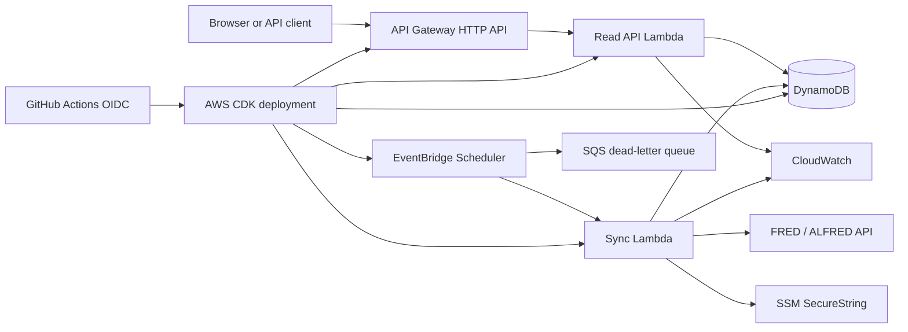

# AWS architecture

This document describes a planned target architecture for v1.0. None of these AWS resources are deployed today. Deployment begins only after the storage adapter, infrastructure code, IAM policies, and cost controls have been implemented and reviewed.

## Goals

- Run the public read API without an always-on server.
- Refresh economic data on a schedule.
- Keep the FRED key out of the API runtime.
- Give each function only the permissions it needs.
- Make the entire environment reproducible from source control.
- Keep an idle portfolio deployment inexpensive.

## Proposed design

### Read API

Use the existing FastAPI application as one Python Lambda Event Function behind an API Gateway HTTP API. Keeping it as a small “lambdalith” preserves the tested HTTP interface during the first migration. Splitting every route into a separate function would add deployment and IAM complexity without improving this low-traffic read API.

The function uses on-demand Lambda capacity because portfolio traffic is intermittent and should scale to zero. API Gateway HTTP API is sufficient because the project does not need REST API features such as API keys, usage plans, response transformation, or built-in caching.

The read function receives read-only access to the DynamoDB table. It does not receive the FRED key or permission to write data.

### Scheduled sync

EventBridge Scheduler invokes a separate sync Lambda once per day. The job refreshes a recent observation window and writes the resulting vintages to DynamoDB. The operation must remain idempotent because scheduled delivery and Lambda invocation are at least once.

The scheduler uses a retry policy and an SQS dead-letter queue. The sync function can read the FRED key from an SSM SecureString parameter and can write only to the AsOf table. It has no API Gateway permissions.

### DynamoDB data model

One planned table stores series metadata, an active-generation manifest for each observation, and immutable vintage generations.

| Item | Partition key | Sort key | Important attributes |
| --- | --- | --- | --- |
| Series metadata | `SERIES#PAYEMS` | `META` | title, units, frequency |
| Observation manifest | `SERIES#PAYEMS` | `OBS#2008-08-01` | `active_generation`, vintage count, updated time |
| Vintage value | `SERIES#PAYEMS#OBS#2008-08-01#GEN#<id>` | `VINTAGE#2008-09-05` | value |
| Cleanup record | `SERIES#PAYEMS` | `RETIRE#2008-08-01#<id>` | generation key, `delete_after` |

The manifest is a per-observation pointer, not a copy of the revision history. Vintage items are never changed after their generation is written. This layout supports the current access patterns without a table scan:

- List observations by querying `SERIES#<id>` with an `OBS#` sort-key prefix.
- Load a full history by reading the manifest and querying its active generation.
- Find the latest vintage on or before an as-of date by reading the manifest, then querying the active generation with an upper sort-key bound, descending order, and a limit of one.

The manifest `GetItem` uses `ConsistentRead=true`. [DynamoDB defaults to eventually consistent reads](https://docs.aws.amazon.com/amazondynamodb/latest/developerguide/HowItWorks.ReadConsistency.html), which could briefly return the previous pointer after a completed sync; a strongly consistent read ensures the request pins the latest successfully published generation. The manifest is stored in the base table because global secondary indexes do not support strongly consistent reads.

The PostgreSQL and SQLite stores remain supported and keep their existing whole-batch transactions. The planned DynamoDB adapter will implement the same `RevisionStore` interface, whose portable guarantee is narrower: one observation history becomes visible atomically, while a multi-observation sync may become visible observation by observation.

### Publishing a generation

Each observation is published independently:

1. Read its manifest with a strongly consistent read and remember the current generation, `G0`.
2. Write the `RETIRE` record for the new generation, `G1`, before writing any vintage items. Its initial `delete_after` is 30 minutes after staging begins, so a crash during staging still leaves a durable cleanup record.
3. Write the complete replacement history under the immutable `G1` partition. Retried writes use the same generation identifier and values, so this staging step is idempotent.
4. Publish `G1` with a transaction containing the [conditional manifest update](https://docs.aws.amazon.com/amazondynamodb/latest/developerguide/Expressions.ConditionExpressions.html) and, when `G0` exists, an update to `G0`'s `RETIRE` record. The manifest condition requires `active_generation = G0`; the first publication instead requires that `active_generation` does not exist. The `G0` cleanup deadline becomes 30 minutes after this publication.
5. If the condition fails, another sync has already changed the pointer. The losing sync must not overwrite it: it re-reads the manifest before deciding whether another refresh is needed, and the prewritten `G1` record makes its unused generation eligible for later cleanup.

The conditional manifest update is the commit point. Readers see either the complete old generation or the complete new generation, and two overlapping syncs that started from the same pointer cannot overwrite one another.

### Retiring old generations

Every generation receives a cleanup record before staging starts. This ordering means a sync that crashes after writing some or all of `G1`, but before updating the manifest, cannot leave an untracked orphan.

The pre-staging record is due 30 minutes after staging begins. If the generation becomes active, cleanup keeps the record but skips deletion. When a later sync replaces that generation, the same transaction as the conditional manifest update moves its `delete_after` time to **30 minutes after** the new publication.

Cleanup performs a strongly consistent manifest read immediately before deleting a due generation and never removes the active generation. Deleting vintages and their cleanup record is idempotent, so an interrupted cleanup can be retried.

The grace period is deliberately longer than [Lambda's 15-minute maximum runtime](https://docs.aws.amazon.com/lambda/latest/dg/gettingstarted-limits.html) for the planned on-demand functions. A read Lambda that obtained `G0` immediately before the pointer moved to `G1` therefore has enough time to finish querying `G0`; the extra 15 minutes provides a conservative buffer for scheduling and cleanup clock differences. Cleanup may run later than `delete_after`, but never earlier.

A generation created by a losing overlapping sync follows the same 30-minute rule even though no reader should have received its identifier.

## Infrastructure and delivery

AWS CDK in Python will define the API, functions, table, schedule, queue, log groups, alarms, IAM roles, and budget. CDK is preferred here because the project benefits from reusable constructs and testable infrastructure while remaining in the same language as the application.

GitHub Actions will authenticate to AWS with OpenID Connect. The deployment role will trust only this repository and the protected deployment environment; the repository will not store long-lived AWS access keys.

The first deployment remains manual. Automatic production deployment can be enabled after a smoke test verifies the health endpoint, one point-in-time query, and one scheduled sync.

## Security boundaries

- Separate IAM roles for the API, sync job, and deployment workflow.
- Exact table, queue, parameter, and log resource permissions; no wildcard administrative policies.
- FRED key stored as an encrypted parameter and available only to the sync function.
- Public API accepts reads only and validates dates and series identifiers at the handler boundary.
- DynamoDB encryption at rest and HTTPS in transit use AWS-managed defaults initially.
- CloudTrail records infrastructure and IAM changes.

## Observability

- Structured JSON logs with a finite retention period.
- CloudWatch alarms for Lambda errors, throttles, high duration, and dead-letter queue depth.
- A custom sync metric for observations and vintages stored.
- Correlation IDs propagated from API Gateway into application logs.

## Cost controls

- On-demand Lambda functions with no provisioned concurrency.
- DynamoDB sized for portfolio traffic with no global tables or backups enabled initially.
- API Gateway HTTP API rather than REST API.
- AWS Budget alert at $5 and a second alert before the account's approved monthly limit.
- One AWS region, proposed as `us-east-2` (Ohio), pending approval before deployment.

## Delivery sequence

1. Add the DynamoDB storage adapter and contract tests.
2. Add thin Lambda handlers around the existing API and sync logic.
3. Define the CDK stack and infrastructure tests.
4. Add GitHub OIDC deployment with a protected environment.
5. Review the synthesized CloudFormation template and estimated resources.
6. Deploy manually, run smoke tests, and enable the daily schedule.

Until those steps are complete, this document is a design proposal rather than a description of running infrastructure.
