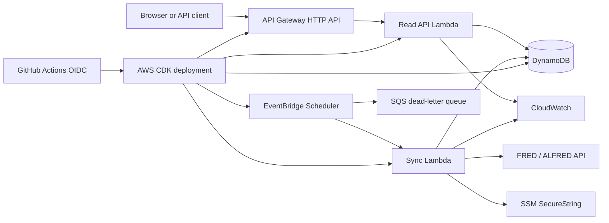

# AWS architecture

This document describes the target architecture for v1.0. These resources do not exist yet; deployment begins only after the infrastructure code, IAM policies, and cost controls have been reviewed.

## Goals

- Run the public read API without an always-on server.
- Refresh economic data on a schedule.
- Keep the FRED key out of the API runtime.
- Give each function only the permissions it needs.
- Make the entire environment reproducible from source control.
- Keep an idle portfolio deployment inexpensive.

## Proposed design

### Read API

Use the existing FastAPI application as one Python Lambda Event Function behind an API Gateway HTTP API. Keeping it as a small “lambdalith” preserves the tested HTTP interface during the first migration. Splitting every route into a separate function would add deployment and IAM complexity without improving this low-traffic read API.

The function uses on-demand Lambda capacity because portfolio traffic is intermittent and should scale to zero. API Gateway HTTP API is sufficient because the project does not need REST API features such as API keys, usage plans, response transformation, or built-in caching.

The read function receives read-only access to the DynamoDB table. It does not receive the FRED key or permission to write data.

### Scheduled sync

EventBridge Scheduler invokes a separate sync Lambda once per day. The job refreshes a recent observation window and writes the resulting vintages to DynamoDB. The operation must remain idempotent because scheduled delivery and Lambda invocation are at least once.

The scheduler uses a retry policy and an SQS dead-letter queue. The sync function can read the FRED key from an SSM SecureString parameter and can write only to the AsOf table. It has no API Gateway permissions.

### DynamoDB data model

One table stores series metadata, observation summaries, and individual vintages.

| Item | Partition key | Sort key |
| --- | --- | --- |
| Series metadata | `SERIES#PAYEMS` | `META` |
| Observation summary | `SERIES#PAYEMS` | `OBS#2008-08-01` |
| Vintage value | `SERIES#PAYEMS` | `VINTAGE#2008-08-01#2008-09-05` |

This layout supports the current access patterns without a table scan:

- List observations with an `OBS#` key prefix.
- Load a full revision history with a `VINTAGE#<observation-date>#` key prefix.
- Find the latest vintage on or before an as-of date with a bounded, descending query and a limit of one.

The PostgreSQL and SQLite stores remain supported. DynamoDB will implement the same `RevisionStore` interface so business logic stays independent of AWS.

## Infrastructure and delivery

AWS CDK in Python will define the API, functions, table, schedule, queue, log groups, alarms, IAM roles, and budget. CDK is preferred here because the project benefits from reusable constructs and testable infrastructure while remaining in the same language as the application.

GitHub Actions will authenticate to AWS with OpenID Connect. The deployment role will trust only this repository and the protected deployment environment; the repository will not store long-lived AWS access keys.

The first deployment remains manual. Automatic production deployment can be enabled after a smoke test verifies the health endpoint, one point-in-time query, and one scheduled sync.

## Security boundaries

- Separate IAM roles for the API, sync job, and deployment workflow.
- Exact table, queue, parameter, and log resource permissions; no wildcard administrative policies.
- FRED key stored as an encrypted parameter and available only to the sync function.
- Public API accepts reads only and validates dates and series identifiers at the handler boundary.
- DynamoDB encryption at rest and HTTPS in transit use AWS-managed defaults initially.
- CloudTrail records infrastructure and IAM changes.

## Observability

- Structured JSON logs with a finite retention period.
- CloudWatch alarms for Lambda errors, throttles, high duration, and dead-letter queue depth.
- A custom sync metric for observations and vintages stored.
- Correlation IDs propagated from API Gateway into application logs.

## Cost controls

- On-demand Lambda functions with no provisioned concurrency.
- DynamoDB sized for portfolio traffic with no global tables or backups enabled initially.
- API Gateway HTTP API rather than REST API.
- AWS Budget alert at $5 and a second alert before the account's approved monthly limit.
- One AWS region, proposed as `us-east-2` (Ohio), pending approval before deployment.

## Delivery sequence

1. Add the DynamoDB storage adapter and contract tests.
2. Add thin Lambda handlers around the existing API and sync logic.
3. Define the CDK stack and infrastructure tests.
4. Add GitHub OIDC deployment with a protected environment.
5. Review the synthesized CloudFormation template and estimated resources.
6. Deploy manually, run smoke tests, and enable the daily schedule.
